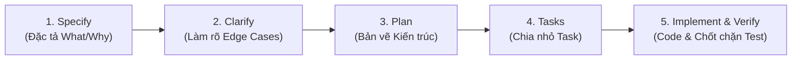

# 📐 Trọ Xinh — Spec-Driven Development (SDD) Standard
> Chuẩn hóa theo triết lý **GitHub Spec Kit** (`github/spec-kit`): Ý định & Đặc tả là nguồn chân lý (Source of Truth).

---

## 🎯 Mục đích & Triết lý
1. **Intent-first, Code-second:** Không bao giờ viết code trước khi có đặc tả và kế hoạch được duyệt.
2. **Ngăn chặn phá vỡ mã nguồn:** Mọi thay đổi lớn phải có checklist kiểm thử và chốt chặn an toàn (Quality Gates).
3. **Lưu vết quyết định kỹ thuật:** Toàn bộ lịch sử đặc tả tính năng được lưu trữ trực tiếp trong kho mã nguồn Git tại thư mục `specs/`.

---

## 🔄 Quy trình 5 bước phát triển tính năng mới

### Bước 1: Khởi tạo Đặc tả (`specs/<feature-name>/spec.md`)
* Sử dụng mẫu `specs/templates/SPEC_TEMPLATE.md`.
* Trả lời rõ: Tính năng này giải quyết bài toán gì cho ai? Tiêu chí nghiệm thu (Acceptance Criteria) là gì?

### Bước 2: Phỏng vấn & Làm rõ (`Clarify`)
* AI hoặc Dev đặt câu hỏi làm rõ các trường hợp ngoại lệ (Edge cases), xử lý lỗi, phân quyền (Role) trước khi bắt tay thiết kế.

### Bước 3: Lập kế hoạch kỹ thuật (`specs/<feature-name>/plan.md`)
* Sử dụng mẫu `specs/templates/PLAN_TEMPLATE.md`.
* Thiết kế chi tiết luồng dữ liệu: Frontend ➔ Backend/API ➔ Firebase Auth ➔ Supabase DB/RLS ➔ Vercel.

### Bước 4: Danh sách Task tuần tự (`specs/<feature-name>/tasks.md`)
* Sử dụng mẫu `specs/templates/TASKS_TEMPLATE.md`.
* Chia nhỏ thành từng đầu việc cụ thể, có thể kiểm chứng độc lập.

### Bước 5: Triển khai & Kiểm thử (Implement & Gate Verification)
* Thực hiện từng task.
* Chạy `npm run build` và toàn bộ bộ test tự động trước khi đóng task.

