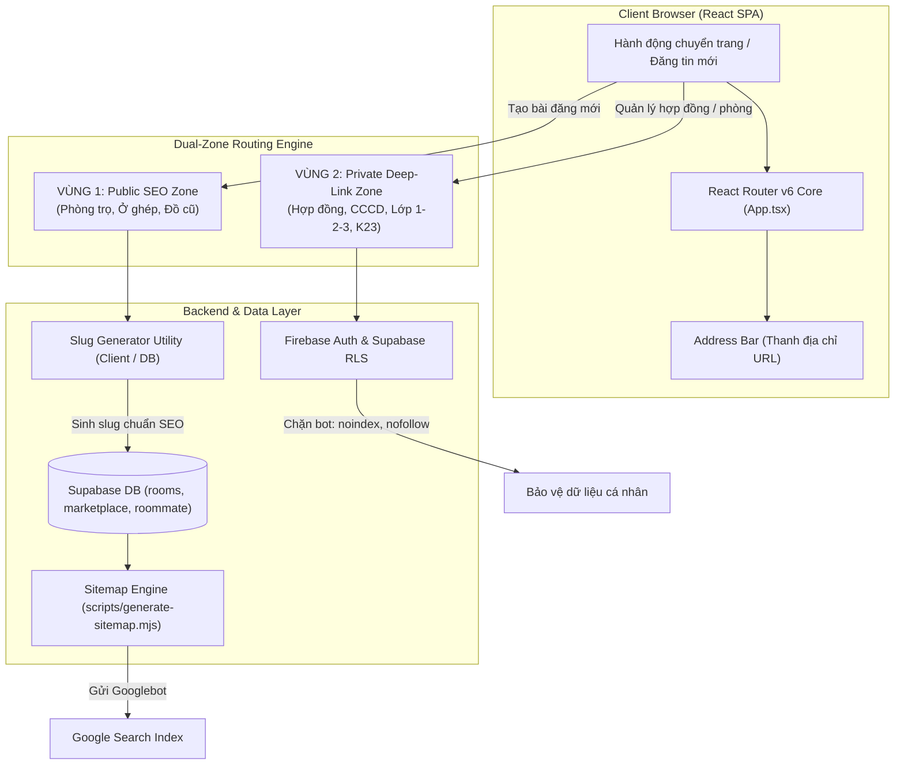

# Kế Hoạch Kỹ Thuật: Hệ Thống Tự Động Hóa URL & Định Tuyến Hai Vùng
> Liên kết Đặc tả: [spec.md](./spec.md)  
> Trạng thái: Draft / Pending Approval  
> Ngày lập: 2026-11-22  

---

## 1. Bản vẽ Kiến trúc & Luồng dữ liệu (Data Flow)

Hệ thống định tuyến chia làm 2 vùng chiến lược độc lập:



---

## 2. Quy Chuẩn Cấu Trúc URL (Routing Architecture Standards)

### 2.1 Vùng 1: URL Công Khai Chuẩn SEO (Public Semantic Slugs)
* **Nguyên tắc:** Dễ đọc cho người dùng, chứa từ khóa tìm kiếm (Loại hình + Quận huyện + Tên bài đăng + ID hash ngắn).
* **Quy chuẩn đường dẫn:**
  * Phòng trọ: `/phong-tro/:district/:slug` (Ví dụ: `/phong-tro/cau-giay/phong-studio-ban-cong-full-do-p302-a8f2`)
  * Tìm ở ghép: `/tim-o-ghep/:district/:slug` (Ví dụ: `/tim-o-ghep/dong-da/nam-sinh-vien-bach-khoa-tim-ban-b9c1`)
  * Chợ đồ cũ: `/cho-do-cu/:category/:slug` (Ví dụ: `/cho-do-cu/do-dien-tu/tu-lanh-mini-90l-con-moi-e3d4`)
* **Hỗ trợ ngược (Backward Compatibility):**
  * Các route cũ như `/phong/:id`, `/roommate/:id`, `/cho-do-cu/:id` vẫn tiếp tục hoạt động, tự động tra cứu ID và chuyển tiếp mượt mà đến URL chuẩn SEO.

### 2.2 Vùng 2: URL Quản Trị & Nghiệp Vụ Sâu (Private Deep Links)
* **Nguyên tắc:** Ngắn gọn, RESTful, phản ánh đúng cấu trúc phân tầng phân cấp nghiệp vụ, tuyệt đối bảo mật.
* **Cấu trúc 3 Lớp Sổ Khách & Hợp Đồng:**
  * **Lớp 1 (Tổng quan lưới phòng & cọc):** `/chu-tro/hop-dong`
  * **Lớp 2 (Danh sách cư trú phòng cụ thể):** `/chu-tro/hop-dong/phong/:roomId`
  * **Lớp 3 (Hồ sơ hợp đồng & CCCD cá nhân):** `/chu-tro/hop-dong/chi-tiet/:contractId`
* **Cấu trúc Tiện ích K23 PMS:**
  * Chốt điện nước: `/chu-tro/dien-nuoc` & `/chu-tro/dien-nuoc/:roomId`
  * Hóa đơn tiền phòng: `/chu-tro/hoa-don` & `/chu-tro/hoa-don/:invoiceId`
  * Đẩy tin VIP phòng: `/chu-tro/day-tin` & `/chu-tro/day-tin/:roomId`
* **Thẻ Meta Bảo Mật:** Mọi trang thuộc vùng 2 tự động gắn `<meta name="robots" content="noindex, nofollow" />`.

---

## 3. Thiết kế Cơ sở Dữ liệu & 1-Click SQL (Database Schema)

Để hỗ trợ slug chuẩn SEO cho các bảng dữ liệu công khai, bổ sung cột `slug` có chỉ mục `UNIQUE` (không làm ảnh hưởng tới khóa chính `id` đang chạy).

```sql
-- ============================================================================
-- TRỌ XINH: MIGRATION TỰ ĐỘNG SINH VÀ LƯU TRỮ SLUG CHUẨN SEO
-- ============================================================================

-- 1. Bổ sung cột slug cho bảng rooms (nếu chưa có)
ALTER TABLE public.rooms 
ADD COLUMN IF NOT EXISTS slug TEXT;

CREATE UNIQUE INDEX IF NOT EXISTS idx_rooms_slug ON public.rooms(slug);

-- 2. Bổ sung cột slug cho bảng marketplace_items (nếu chưa có)
ALTER TABLE public.marketplace_items 
ADD COLUMN IF NOT EXISTS slug TEXT;

CREATE UNIQUE INDEX IF NOT EXISTS idx_marketplace_items_slug ON public.marketplace_items(slug);

-- 3. Bổ sung cột slug cho bảng roommate_posts (nếu chưa có)
ALTER TABLE public.roommate_posts 
ADD COLUMN IF NOT EXISTS slug TEXT;

CREATE UNIQUE INDEX IF NOT EXISTS idx_roommate_posts_slug ON public.roommate_posts(slug);

-- 4. Hàm PostgreSQL tự động sinh slug tiếng Việt không dấu
CREATE OR REPLACE FUNCTION public.generate_seo_slug(title_text TEXT, record_id TEXT)
RETURNS TEXT AS $$
DECLARE
  clean_title TEXT;
  short_id TEXT;
BEGIN
  -- Lấy 6 ký tự cuối của ID để chống trùng lặp
  short_id := RIGHT(REPLACE(record_id, '-', ''), 6);
  
  -- Chuyển đổi tiếng Việt có dấu thành không dấu
  clean_title := lower(unaccent(title_text));
  -- Thay thế ký tự không phải chữ và số thành dấu gạch ngang
  clean_title := regexp_replace(clean_title, '[^a-z0-9]+', '-', 'g');
  -- Loại bỏ gạch ngang ở đầu và cuối
  clean_title := trim(both '-' from clean_title);
  -- Giới hạn độ dài tối đa 80 ký tự
  clean_title := substring(clean_title from 1 for 80);
  
  RETURN clean_title || '-' || short_id;
END;
$$ LANGUAGE plpgsql IMMUTABLE;
```

---

## 4. Thiết kế Skill / Chốt chặn Kiểm soát URL (`troxinh-routing-guard`)

Tạo mới một Skill cho AI Assistant: `.agents/skills/troxinh-routing-guard/SKILL.md`.

### Quy trình tự động của Skill:
1. **Phát hiện Trang Mới:** Khi một file React component mới được tạo trong `src/pages/` hoặc một phân tầng mới được chia tách trong `src/components/`.
2. **Kiểm tra đăng ký trong `src/App.tsx`:**
   * File đó đã được import và gắn thẻ `<Route path="..." element={<... />} />` chưa?
   * Nếu là trang quản trị, đã được bọc trong `<ProtectedRoute>` chưa?
   * Đã có breadcrumb hoặc nút Back đồng bộ với lịch sử trình duyệt chưa?
3. **Kiểm tra SEO / Noindex:**
   * Trang công khai: Có `react-helmet-async` thiết lập Title, Meta Description, Canonical URL chưa?
   * Trang nội bộ: Đã bật `noindex, nofollow` chưa?

---

## 5. Kế hoạch Quản lý Trạng thái & Cache
* **URL làm Single Source of Truth cho vị trí:** Thay vì lưu tầng đang mở (Lớp 1, 2, 3) vào biến `useState`, component đọc trực tiếp từ `useParams()` (`roomId`, `contractId`).
* **TanStack Query:** Dùng query key đồng bộ với URL params:
  ```ts
  useQuery({
    queryKey: ['contract-details', contractId],
    queryFn: () => fetchContractById(contractId),
    enabled: !!contractId,
  });
  ```
* **Zustand:** Chỉ lưu trạng thái UI cục bộ (ví dụ: đang mở modal lọc nâng cao, đang gõ dở tìm kiếm).

---

## 6. Kế hoạch Kiểm thử & Chốt chặn (Quality Gates)
1. **Kiểm tra kiểu dữ liệu:** `npm run lint` (hoặc `npx tsc --noEmit`) đạt 100% không lỗi type.
2. **Kiểm tra biên dịch:** `npm run build` chạy trơn tru, không có dead chunk hoặc circular dependency.
3. **Kiểm thử tự động:** Viết script kiểm tra sitemap và route resolution (`scripts/test-routing-parity.mjs`).
