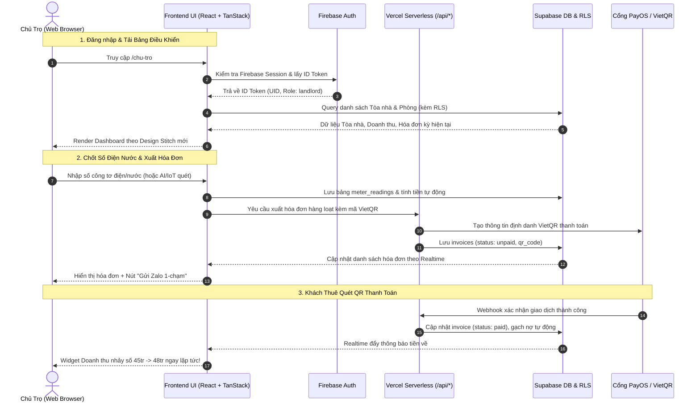

# Kế Hoạch Kỹ Thuật: Tái Cấu Trúc Giao Diện Phân Hệ Chủ Trọ (Landlord Redesign)
> Nguồn thiết kế: Google Stitch MCP (Project ID: `2677664159020999894` - Nền Tảng Trọ Xinh Việt Nam)  
> Mục tiêu: Chuẩn hóa toàn bộ trải nghiệm Web Chủ trọ theo thiết kế Stitch mới, nối 100% trang cũ có sẵn, không sinh trang rác.  
> Trạng thái: **Draft / Sẵn sàng phê duyệt**  

---

## 1. Bản vẽ Kiến trúc & Luồng Dữ liệu (Data Flow)

Hệ thống tuân thủ nghiêm ngặt quy tắc kiến trúc bắt buộc của Trọ Xinh:
* **Frontend Web (React + Vite + Tailwind + Lucide):** 
  - Render giao diện Web responsive, đồng bộ Design System từ Stitch (Primary `#27ae60`, Neutral `#f9f9f9`, Font *Be Vietnam Pro*).
  - Quản lý dữ liệu máy chủ qua **TanStack Query** (cache, revalidation, optimistic update).
  - Quản lý trạng thái UI cục bộ qua **Zustand** (sidebar toggle, modal open/close, active filter tòa nhà/kỳ thanh toán).
* **Xác thực (Firebase Auth):**
  - Quản lý phiên đăng nhập duy nhất bằng Firebase Auth SDK.
  - Mỗi request bảo mật gửi kèm `Authorization: Bearer <Firebase_ID_Token>`.
  - Phân quyền theo vai trò `app_role = 'landlord'` gắn liền với `firebase_uid`.
* **Backend API & Serverless (Vercel Functions):**
  - Endpoint `/api/*` chạy trên Vercel Serverless (Node.js runtime).
  - Xác thực token bằng Firebase Admin SDK (`verifyFirebaseIdToken()`).
  - Xử lý các tác vụ nhạy cảm: Tạo link thanh toán PayOS / VietQR, Webhook gạch nợ tự động, gửi tin nhắn Zalo ZNS/webhook, tích hợp IoT K23.
* **Cơ sở dữ liệu & Realtime & Storage (Supabase):**
  - Nguồn dữ liệu nghiệp vụ duy nhất: `profiles`, `buildings`, `rooms`, `tenants`, `contracts`, `invoices`, `meter_readings`, `wallet_transactions`, `k23_iot_devices`.
  - **Supabase RLS (Row Level Security):** Kiểm soát bảo mật tầng hàng theo `firebase_uid` của chủ trọ (`auth.uid() = user_id` hoặc RPC kiểm tra `owner_id`).
  - **Supabase Realtime:** Lắng nghe biến động trạng thái phòng, tin nhắn khách thuê, thông báo nộp tiền theo thời gian thực.
  - **Supabase Storage:** Lưu trữ ảnh phòng trọ, ảnh chụp hợp đồng, ảnh công tơ điện nước.
* **Hosting & CDN (Vercel):**
  - Build và phân phối SPA React và API Serverless trên hạ tầng Vercel Production.

---

## 2. Bản Đồ Nối Các Trang Cũ Có Sẵn (Không Sinh Trang Thừa)

Tất cả các file trang trong `src/pages/` được giữ nguyên cấu trúc URL, không tạo trang song song, chỉ tái cấu trúc mã hiển thị bên trong theo chuẩn giao diện Stitch:

| STT | File Hiện Có (`src/pages/`) | Đường dẫn URL | Vai trò theo Thiết kế Stitch |
|:---:|:---|:---|:---|
| 1 | `OwnerDashboardPage.tsx` | `/chu-tro`, `/chu-tro/tong-quan` | **Bảng Điều Khiển Chủ Trọ** (Doanh thu, Quick Actions, Checklist, Quota) |
| 2 | `OwnerBuildingListPage.tsx` | `/chu-tro/toa-nha` | **Tòa nhà của tôi** (Danh sách tòa nhà, số phòng, tỷ lệ lấp đầy) |
| 3 | `OwnerBuildingDetailPage.tsx` | `/chu-tro/toa-nha/:id` | **Chi tiết tòa nhà** (Danh sách tầng/phòng, cấu hình tiện ích & dịch vụ) |
| 4 | `OwnerCreateBuildingPage.tsx` | `/chu-tro/toa-nha/tao-moi` | **Tạo hồ sơ tòa nhà** (Form thêm tòa mới) |
| 5 | `OwnerCreateRoomPage.tsx` | `/chu-tro/phong/tao-moi` | **Đăng phòng trọ** (Nhập thông tin phòng, giá thuê, ảnh) |
| 6 | `OwnerRoomDetailPage.tsx` | `/chu-tro/phong/:id` | **Chi tiết phòng chủ trọ** (Trạng thái phòng, khách thuê hiện tại, lịch sử) |
| 7 | `OwnerContractsPage.tsx` | `/chu-tro/hop-dong` | **Sổ khách & Hợp đồng** (Quản lý khách trọ, CCCD, ngày hết hạn HĐ) |
| 8 | `OwnerMeterReadingPage.tsx` | `/chu-tro/chot-so` | **Chốt số điện nước** (Ghi chỉ số, đối chiếu tháng trước) |
| 9 | `OwnerInvoiceListPage.tsx` | `/chu-tro/hoa-don` | **Hóa đơn** (Danh sách phiếu thu, lọc theo trạng thái Đã thu / Chưa thu / Quá hạn) |
| 10 | `OwnerInvoiceDetailPage.tsx` | `/chu-tro/hoa-don/:id` | **Chi tiết hóa đơn** (Xem phiếu thu, mã VietQR, nút nhắc nợ Zalo) |
| 11 | `OwnerServicesPage.tsx` | `/chu-tro/dich-vu` | **Quản Lý Biểu Phí Dịch Vụ** (Đơn giá điện, nước, rác, wifi, thang máy) |
| 12 | `OwnerK23PricingPage.tsx` | `/chu-tro/goi-dich-vu` | **Bảng giá gói K23** (Bảng tính năng Freemium / Pro / Doanh nghiệp) |
| 13 | `OwnerK23CheckoutPage.tsx` | `/chu-tro/thanh-toan-goi` | **Thanh toán gói K23** (Quét QR PayOS nâng cấp gói) |
| 14 | `OwnerK23SubscriptionPage.tsx` | `/chu-tro/quan-ly-goi-k23` | **Gói quản lý K23** (Xem gói đang dùng, thời hạn, hạn mức phòng) |
| 15 | `OwnerWalletPage.tsx` | `/chu-tro/vi-xu` | **Ví Xu Trọ Xinh** (Số dư Xu, nạp Xu, lịch sử dùng Xu mua tin/dịch vụ) |
| 16 | `OwnerBoostRoomPage.tsx` | `/chu-tro/day-tin` | **Đẩy tin VIP** (Chọn vị trí đẩy tin trang chủ/tìm kiếm) |
| 17 | `OwnerBookingsPage.tsx` | `/chu-tro/lich-hen` | **Lịch hẹn xem phòng** (Quản lý khách hẹn xem phòng, xác nhận/đổi lịch) |
| 18 | `OwnerChatPage.tsx` | `/chu-tro/tin-nhan` | **Tin nhắn** (Chat trực tiếp với khách thuê và khách tiềm năng) |
| 19 | `OwnerNotificationsPage.tsx` | `/chu-tro/thong-bao` | **Trung tâm thông báo** (Tin hệ thống, tiền phòng về, lịch hẹn) |
| 20 | `OwnerProfilePage.tsx` | `/chu-tro/toi` | **Hồ sơ Chủ trọ** (Thông tin cá nhân, định danh CCCD, tài khoản nhận tiền) |
| 21 | `OwnerOnboardingPage.tsx` | `/chu-tro/onboarding` | **Onboarding Chủ trọ** (Hướng dẫn 3 bước cho chủ trọ mới) |
| 22 | `K23MonthlyDemoPage.tsx` | `/demo-hoa-don`, `/chu-tro/demo-k23` | **Demo 1 tháng K23** (Dữ liệu mẫu giúp chủ trọ trải nghiệm trước khi dùng thật) |

---

## 3. Quy Chuẩn Giao Diện (Stitch Design Tokens)

* **Font chữ:** `Be Vietnam Pro` cho toàn bộ UI (Display, Headline, Body, Label).
* **Bảng màu chủ đạo:**
  - `primary`: `#006d37` (Dark emerald xanh đậm cho nút chính, icon active)
  - `primary_container`: `#27ae60` (Màu xanh thương hiệu Trọ Xinh)
  - `secondary_container`: `#ffa454` (Màu cam ấm cho cảnh báo, tin VIP, gói nổi bật)
  - `surface`: `#f9f9f9` (Màu nền tổng thể giao diện)
  - `surface_container`: `#eeeeee` (Màu nền thẻ card, viền phân cách)
  - `text_primary`: `#1a1c1c`
* **Cấu trúc Khung Layout Thống Nhất (`DashboardSidebar` & Header):**
  - **Left Sidebar cố định:** Logo Trọ Xinh Chủ trọ, thông tin người dùng mini, menu phân nhóm 2 khối (Vận hành & Tài chính/Dịch vụ), số dư Xu trực quan.
  - **Header điều hướng:** Bộ lọc tòa nhà đa năng (Dropdown chọn Tất cả hoặc Tòa cụ thể), Bộ lọc kỳ tháng (`Tháng 11/2026`), Ô tìm kiếm nhanh, Nút "Đăng phòng mới", Chuông thông báo Realtime.
  - **Nội dung Content:** Tự co giãn theo màn hình (Fluid container max 1440px), responsive hoàn toàn trên Mobile/Tablet.

---

## 4. Kế Hoạch Triển Khai Chi Tiết (Từng Giai Đoạn)

### Giai đoạn 1: Nâng cấp Khung Layout & Navigation Chung (`DashboardSidebar.tsx`)
1. Cập nhật `src/components/layout/DashboardSidebar.tsx` theo đúng nhóm menu và styling của Stitch.
2. Thêm thanh Topbar tiện ích với bộ chọn Tòa nhà & Kỳ tháng gắn vào store UI Zustand (`selectedBuildingId`, `selectedMonthCycle`).

### Giai đoạn 2: Tái cấu trúc Trang Chủ Vận Hành (`OwnerDashboardPage.tsx`)
1. Bố trí lại 4 khối chính của Stitch Dashboard:
   - **Khối 1: Card Quota gói đăng phòng** (Còn 1/2 phòng miễn phí, link mua Xu/nâng gói).
   - **Khối 2: Widget Doanh thu & Tiến độ thu tiền** (Tổng đã thu, chưa thu, quá hạn, tiến độ %).
   - **Khối 3: Thanh Hành Động 1-Chạm (Quick Actions)**: Chốt điện nước, Tạo VietQR, Nhắc Zalo 1-chạm, Đăng phòng trống.
   - **Khối 4: Checklist việc cần làm hôm nay & Bảng trạng thái phòng**.
2. Kết nối toàn bộ dữ liệu thật từ TanStack Query (`useQuery` gọi Supabase `buildings`, `rooms`, `invoices`).

### Giai đoạn 3: Làm mới Phân hệ Tòa Nhà, Phòng & Sổ Khách
1. Sửa `OwnerBuildingListPage.tsx` & `OwnerBuildingDetailPage.tsx` theo thẻ card tòa nhà của Stitch.
2. Sửa `OwnerContractsPage.tsx` (Sổ khách & Hợp đồng) hiển thị danh sách phòng - khách thuê - ngày bắt đầu/kết thúc hợp đồng - tình trạng CCCD/tạm trú.

### Giai đoạn 4: Làm mới Phân hệ Chốt Điện Nước & Hóa Đơn VietQR
1. Sửa `OwnerMeterReadingPage.tsx`: Bảng nhập chỉ số công tơ điện nước theo tầng/phòng, tự tính số tiêu thụ và thành tiền theo đơn giá đã cấu hình.
2. Sửa `OwnerInvoiceListPage.tsx` & `OwnerInvoiceDetailPage.tsx`: Danh sách phiếu thu, xem trước hóa đơn VietQR chuẩn ngân hàng NAPAS 247, nút gửi link Zalo cho khách thuê.

### Giai đoạn 5: Tích hợp Module K23 Nâng Cao & Kiểm Thử Toàn Diện
1. Tích hợp các modal K23 đã có sẵn vào vị trí hợp lý trên giao diện:
   - `IotDeviceManagementModal.tsx` (Chốt số điện nước tự động qua công tơ IoT).
   - `TaxReportModal.tsx` (Báo cáo tổng hợp doanh thu phục vụ kê khai thuế).
2. Chạy `npm run build` và kiểm thử tích hợp, đảm bảo không có bất kỳ lỗi biên dịch hay vỡ giao diện.
