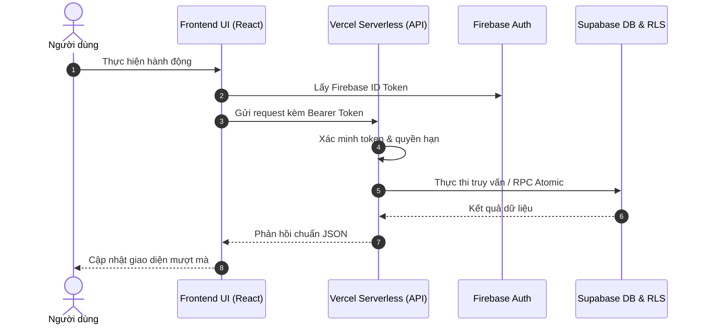

# Kế Hoạch Kỹ Thuật: [TÊN TÍNH NĂNG]
> Liên kết Đặc tả: [spec.md](./spec.md)  
> Trạng thái: Draft / Approved  

---

## 1. Bản vẽ Kiến trúc & Luồng dữ liệu (Data Flow)
Mô tả sự tham gia của các tầng hệ thống:
1. **Frontend (React + Vite):** Component hiển thị, Form validation, Local UI state (Zustand).
2. **Serverless API (Vercel Functions):** Endpoint xử lý nghiệp vụ bảo mật (`api/...`).
3. **Xác thực (Firebase Auth):** Kiểm tra JWT ID Token qua `verifyFirebaseIdToken()`.
4. **Cơ sở dữ liệu (Supabase):** Bảng dữ liệu, Index, RLS Policies, Database Functions/RPCs.

---

## 2. Thiết kế Cơ sở Dữ liệu & RLS (Database Schema)
* **Bảng mới / Cột mới:**
* **Chính sách bảo mật hàng (RLS Policies):**
  * Nguyên tắc: Không để hở dữ liệu cá nhân (`auth.uid() = user_id`).
* **Đoạn mã 1-Click SQL:** (Chỉ chạy trên Supabase SQL Editor).

---

## 3. Quản lý Trạng thái & Cache
* **TanStack Query:** Quản lý dữ liệu máy chủ (Query Keys, Invalidation, Optimistic updates).
* **Zustand:** Chỉ lưu trạng thái UI tạm thời (modal open/close, active tab).
* **Tuyệt đối:** Không dùng localStorage cho dữ liệu tiền tệ, quyền, phiên hay bảo mật.

---

## 4. Kế hoạch Kiểm thử & Chốt chặn (Quality Gates)
* [ ] Kiểm tra kiểu dữ liệu TypeScript (`npm run lint` hoặc `tsc --noEmit`).
* [ ] Chạy Build Production (`npm run build`).
* [ ] Viết test tự động (`scripts/test-*.mjs`).

